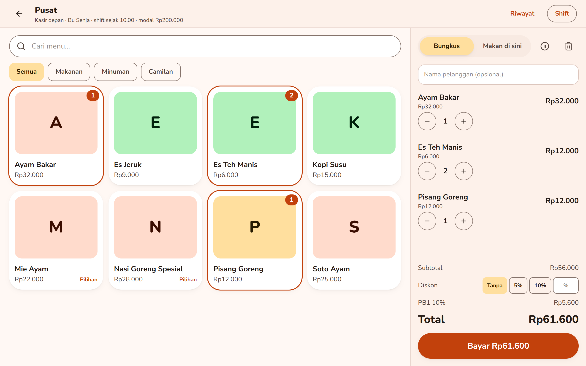
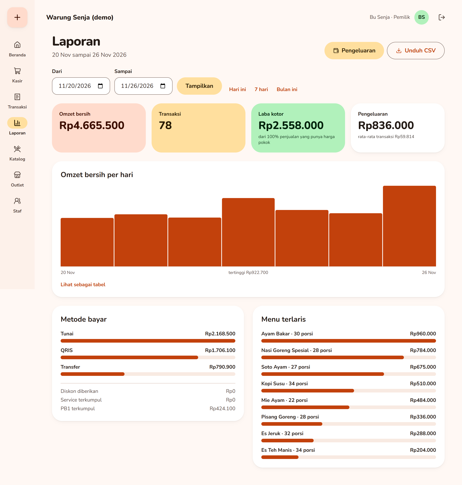
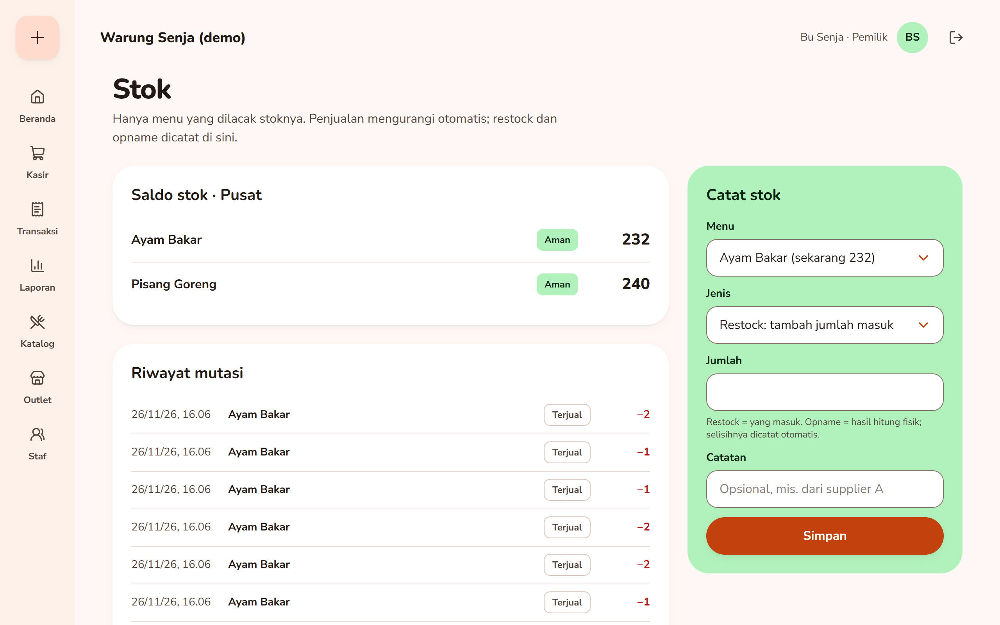
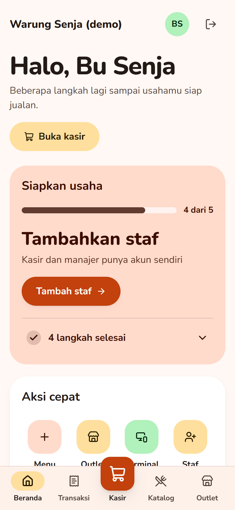
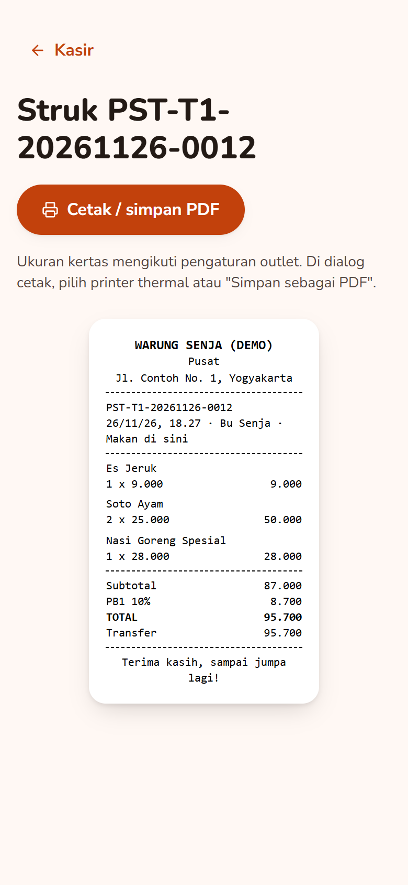

<p>
  <picture>
    <source media="(prefers-color-scheme: dark)" srcset="docs/brand/hone-wordmark-white.svg">
    
  </picture>
</p>

# H One FoodBiz

Open-source point of sale and bookkeeping for small food businesses, from a warung to a restaurant. Ring up orders on a phone or tablet, print receipts (58 mm, 80 mm, A4), track shifts, cash, expenses and stock, read daily reports, and keep selling when the internet drops.

[](https://vercel.com/new/clone?repository-url=https%3A%2F%2Fgithub.com%2FMas-Hanafi%2Fhone-foodbiz&env=NEXT_PUBLIC_SUPABASE_URL,NEXT_PUBLIC_SUPABASE_ANON_KEY&envDescription=Supabase%20project%20URL%20and%20publishable%20(anon)%20key&envLink=https%3A%2F%2Fgithub.com%2FMas-Hanafi%2Fhone-foodbiz%23getting-started&project-name=hone-foodbiz)



| Reports | Stock ledger |
|---|---|
|  |  |

| Dashboard on a phone | Receipt on a phone |
|---|---|
|  |  |

Screenshots use the demo business from `supabase/seed.sql`. All names and figures are fictional.

## What it does

- **Cashier:** menu grid with variants and add-ons, dine-in or takeaway, order discount (cashier cap enforced on the server), cash with rounding, QRIS, transfer, split payment, held orders, printable receipt.
- **Offline:** the cashier screen opens without a connection once it has been opened online on that device (service worker, production builds). If a sale cannot reach the server it is kept on the device and sent automatically when the connection returns. Sale ids are generated on the device and the database ignores an id it already has, so a retry never creates a duplicate. Closing a shift is blocked while that device still holds unsent sales.
- **Shifts and cash:** opening float, cash in/out, expenses paid from the drawer, expected vs counted cash computed by the database at close.
- **Corrections:** void or refund with a manager's 6-digit PIN; sales are never edited or deleted.
- **Back office:** outlets with tax, service and rounding rules, terminals, staff roles (owner, manager, cashier), catalog, stock ledger with restock and stock opname, expenses, and reports (net revenue, gross profit from cost prices, payment methods, top items, CSV export).
- **Access control:** every query runs as the signed-in user and Postgres Row-Level Security decides what they can see. A cashier at one outlet cannot read another outlet's data even through the API directly.

## Stack

Next.js 16 (App Router, server actions), TypeScript, Tailwind v4, Supabase (Postgres, Row-Level Security, Auth). Offline uses a small service worker (`public/sw.js`) and a sale queue in localStorage; receipts use the browser's print dialog.

## Getting started

1. Create a Supabase project and run the files in `supabase/migrations/` in order (SQL editor, or `supabase db push`).
2. Optional demo data: run `supabase/seed.sql`. It creates a demo owner, a menu and 14 days of sales. Sign in as `demo@hone-foodbiz.test` / `demo-foodbiz`. These credentials are public, so change the password or delete that user on a deployment others can reach.
3. Run the app:

```bash
npm install
cp .env.example .env.local   # fill in your Supabase URL and publishable (anon) key
npm run dev
```

Or click **Deploy with Vercel** above and paste the same two values.

Without the demo, sign up at `/signup`: the first account creates a business and becomes its owner. For a quick trial, turn off **Authentication → Email → Confirm email** in Supabase so sign-up logs you straight in. Set `SUPABASE_SERVICE_ROLE_KEY` (server only) to let the owner create staff accounts from **Staf**.

Anyone who can reach `/signup` can create their own isolated business. For a single-business install, disable sign-ups in Supabase after creating the owner.

## Tests

```bash
npm test            # totals and offline-queue logic, plus migrations + RLS against in-process Postgres (PGlite), no Docker needed
npm run typecheck
```

## Docs

- [Product requirements](docs/PRD.md)
- [Data model and access rules](docs/ERD.md)
- [POS wireframe](docs/wireframes/pos.html)

## License

[MIT](LICENSE)
