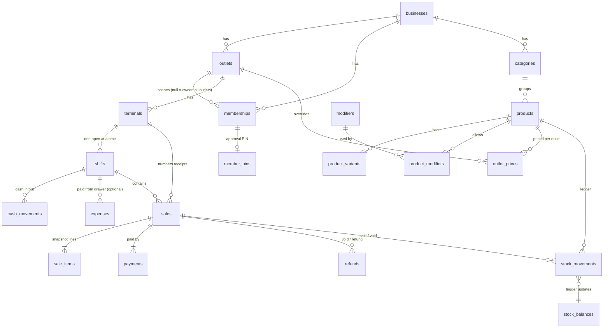

# H One FoodBiz — Data Model

Source of truth: [`supabase/migrations/20261126000000_init.sql`](../supabase/migrations/20261126000000_init.sql).
Tested by [`supabase/tests/schema.test.mjs`](../supabase/tests/schema.test.mjs) (PGlite, no Docker needed).

## Diagram



## Tables

| Group | Table | Notes |
|---|---|---|
| Organization | `businesses` | One per install today; every row elsewhere carries `business_id` for a future hosted mode |
| | `outlets` | Branch. Holds tax/service rates, cashier discount cap, cash rounding, receipt header/footer/logo/paper size |
| | `memberships` | user × business × outlet × role. Owner rows have `outlet_id = null` |
| | `member_pins` | bcrypt hash of a 6-digit approval PIN. RLS on, zero policies: unreadable by any client |
| | `terminals` | Device at an outlet. Its code is part of every receipt number |
| Catalog | `categories`, `products`, `product_variants`, `modifiers`, `product_modifiers` | Business-wide. Variant has its own absolute price |
| | `outlet_prices` | Optional per-outlet price for a product or variant |
| Cash | `shifts` | Opening float, counted vs expected cash at close. One open shift per terminal |
| | `cash_movements` | Petty cash in/out during a shift, reason required |
| | `expenses` | `shift_id` set = paid from the drawer, so it reduces expected cash |
| Sales | `sales` | Header with snapshotted tax/service rates and totals. `total = subtotal − discount + service + tax (if exclusive) + rounding`, enforced by CHECK |
| | `sale_items` | Snapshot: name, variant, modifiers (jsonb), unit price, discount, cost price at sale time |
| | `payments` | Split payments. `change` is a generated column. Non-cash must have `tendered = amount` |
| | `refunds` | `void` = whole sale, same shift, stock returned. `refund` = money only, partial allowed, any time |
| Stock | `stock_movements` | Ledger: `sale`, `void`, `restock`, `adjustment` |
| | `stock_balances` | Updated by trigger in the same transaction. Negative = oversold, flag for review |
| View | `sales_with_status` | Adds `status` (paid / voided / refunded / partially_refunded) and `refunded_amount`. `security_invoker`, so RLS applies |

## Write paths

Clients never insert into `sales`, `sale_items`, `payments` or `refunds` directly. No policy allows it.

| RPC | What it does |
|---|---|
| `create_business(name, outlet_name, outlet_code)` | Business + first outlet + owner membership for the caller |
| `set_my_pin(pin)` | Sets the caller's 6-digit approval PIN |
| `record_sale(jsonb)` | Atomic: header, items, payments, stock movements. Idempotent on the client-generated `id`, so the offline queue can retry blindly. Rejects wrong line totals, payments ≠ total, and a broken total formula |
| `record_refund(...)` | Void or refund. Needs an owner/manager user id + PIN for that outlet. Void only while the shift is open, only once, and reverses stock |
| `close_shift(shift_id, counted)` | Server computes expected cash = float + cash sales (not voided) − cash refunds ± cash movements − drawer expenses |

Direct inserts that are allowed: outlets (owner), memberships (owner), terminals/catalog/outlet prices (owner, manager), shifts (own), cash movements and expenses (own), stock restock/adjustment (owner, manager).

## Access model

| Role | Sees | Writes |
|---|---|---|
| owner | every outlet of the business | everything |
| manager | own outlet; catalog of the whole business | catalog, terminals, prices, stock adjustments, approves voids/refunds |
| cashier | own outlet; catalog | own shifts, sales, cash movements, expenses |

Helpers `has_business_role`, `has_outlet_role`, `can_access_outlet` are `security definer` so policies don't recurse into `memberships` RLS.

## Decisions taken while modelling

1. **Receipt numbers are per terminal, not per outlet.** Format `JKT-T1-20261126-0001`. The terminal generates them, so numbering works offline and stays gap-free per terminal per day. The server enforces uniqueness per outlet.
2. **Client-generated UUIDs** on shifts, sales, refunds, cash movements and expenses replace a separate `client_id` column. Replays become a no-op.
3. **Status is derived, never stored.** Sales stay append-only. Voids and refunds are rows that point at the sale.
4. **Voids, refunds and shift close need a connection.** Cash sales, cash movements and expenses work offline.
5. **No shared-device PIN switching.** Each cashier signs in with their own account. The PIN is only for manager approval.
6. **Dropped from v1:** `audit_logs` (sales/refunds already record who and when; add it when settings changes need a trail) and a separate `receipt_settings` table (merged into `outlets`).

## Known limits

- **No PIN lockout.** A cashier could brute-force a 6-digit PIN by calling `record_refund` repeatedly. Add a failure counter before real-money use.
- **Discount cap** (`max_cashier_discount_pct`) is enforced by the app, not the database. A rejected sync would lose a sale that already happened.
- **Late offline sales.** A sale synced after its shift was closed is accepted, but expected cash for that shift is already fixed. The app must sync the queue before calling `close_shift`.
- **Variants share the product's stock.**

## Running the tests

```bash
npm i -D @electric-sql/pglite
node --test supabase/tests/schema.test.mjs
```
